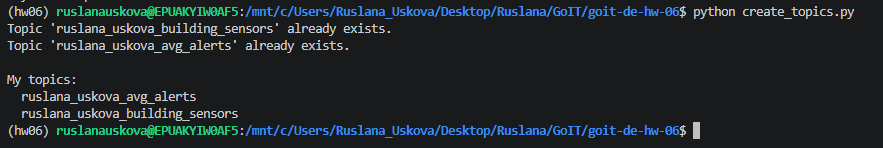
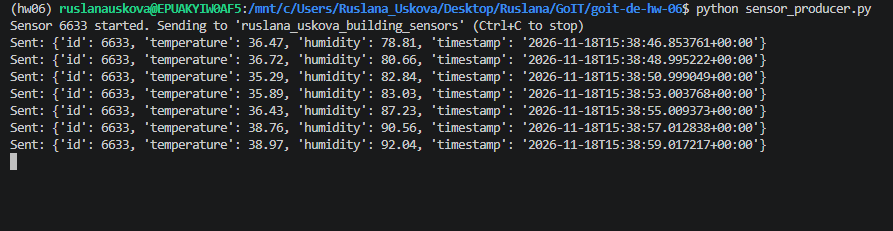
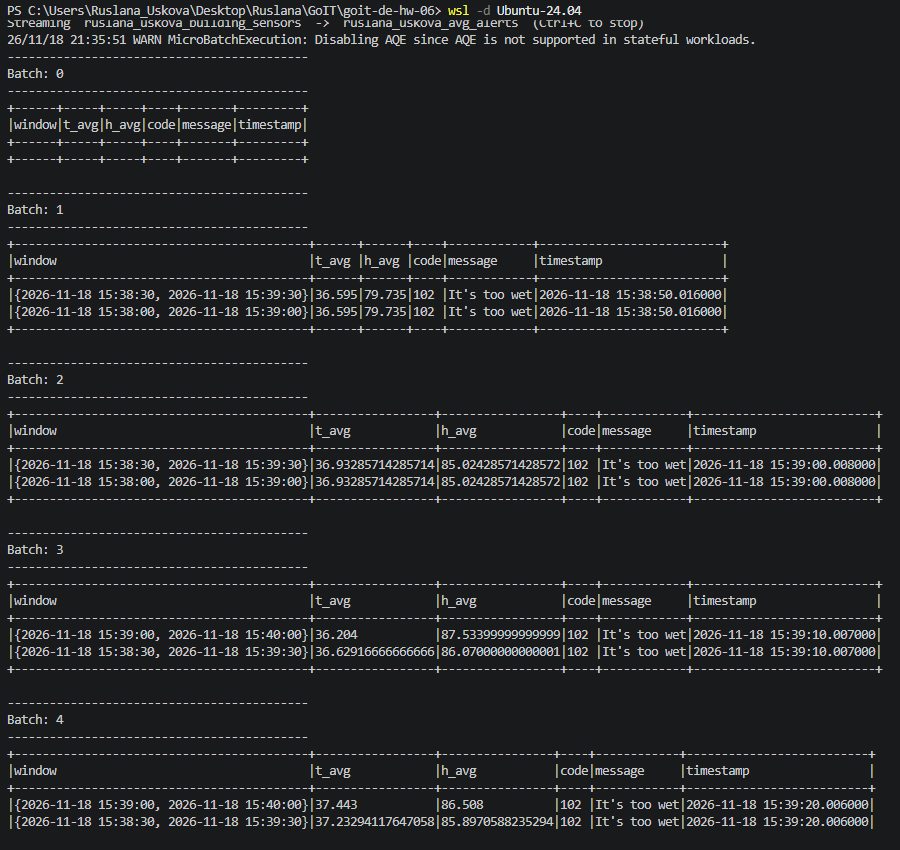
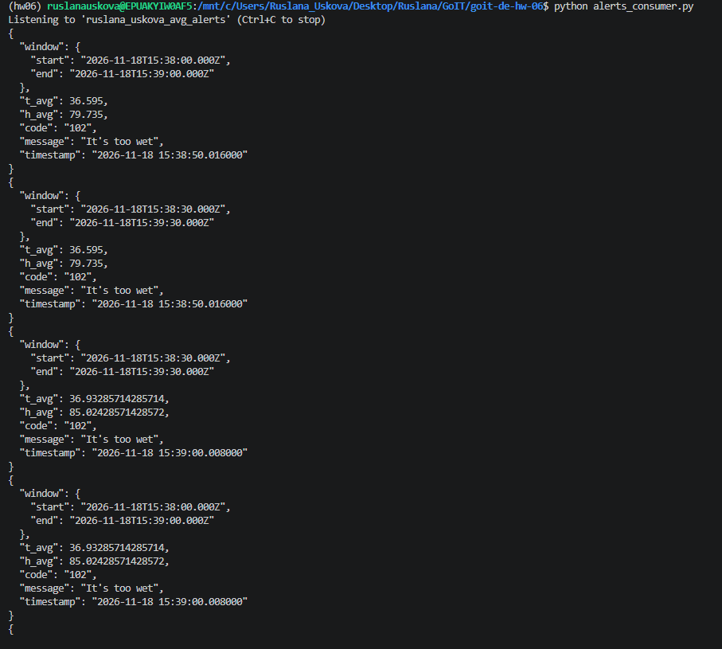

# goit-de-hw-06 — Алерти за середніми показниками датчиків (Kafka + Spark Streaming)

Spark Structured Streaming читає потік показників датчиків з Kafka, рахує середні температуру та вологість у ковзному вікні та записує алерти у вихідний Kafka-топік. Критерії алертів беруться з файлу [alerts_conditions.csv](alerts_conditions.csv), тому змінювати їх можна без змін у коді.

```
sensor_producer.py ──► building_sensors ──► spark_alerts.py ──► avg_alerts ──► alerts_consumer.py
 (N запусків = N датчиків)                   ▲
                                alerts_conditions.csv
```

## Структура проєкту

| Файл | Призначення |
|---|---|
| [configs.py](configs.py) | Параметри підключення до Kafka (для kafka-python і для Spark), імена топіків |
| [serializers.py](serializers.py) | JSON- та string-серіалізатори для kafka-python |
| [create_topics.py](create_topics.py) | Створення топіків `building_sensors` і `avg_alerts` |
| [sensor_producer.py](sensor_producer.py) | Крок 1 — генерація потоку даних датчика |
| [spark_alerts.py](spark_alerts.py) | Кроки 2–5 — агрегація, визначення алертів, запис у Kafka |
| [alerts_consumer.py](alerts_consumer.py) | Читання алертів з вихідного топіку (перевірка результату) |
| [download_jars.py](download_jars.py) | Завантаження Kafka-конектора в `jars/` для запуску Spark без інтернету |
| [alerts_conditions.csv](alerts_conditions.csv) | Критерії алертів |

## Створення топіків

`create_topics.py` створює вхідний топік `ruslana_uskova_building_sensors` і вихідний `ruslana_uskova_avg_alerts`.



## 1. Генерація потоку даних

`sensor_producer.py` кожні 2 секунди надсилає в `ruslana_uskova_building_sensors` повідомлення:

```json
{"id": 2756, "temperature": 17.08, "humidity": 55.95, "timestamp": "2026-11-17T13:43:42.914269+00:00"}
```

Значення змінюються випадковим блуканням (температура 15–60 °C, вологість 10–95 %), тож середні за хвилину поступово проходять різні діапазони і спрацьовують різні алерти. Кожен запуск скрипту — окремий датчик із власним `id`.



## 2. Агрегація даних

```python
sensors.withWatermark("timestamp", "10 seconds")
       .groupBy(F.window("timestamp", "1 minute", "30 seconds"))
       .agg(F.avg("temperature").alias("t_avg"), F.avg("humidity").alias("h_avg"))
```

Вікно довжиною 1 хвилина зсувається кожні 30 секунд, тому кожне вимірювання потрапляє у два вікна, що перекриваються. Watermark 10 секунд визначає, наскільки пізно можуть надходити дані, перш ніж стан вікна буде видалено.

## 3. Параметри алертів

| id | humidity_min | humidity_max | temperature_min | temperature_max | code | message |
|---|---|---|---|---|---|---|
| 1 | 0 | 40 | -999 | -999 | 101 | It's too dry |
| 2 | 60 | 100 | -999 | -999 | 102 | It's too wet |
| 3 | -999 | -999 | -300 | 30 | 103 | It's too cold |
| 4 | -999 | -999 | 40 | 300 | 104 | It's too hot |

`-999` означає, що межа для цього алерту не використовується.

## 4. Визначення алертів

Агреговані середні об'єднуються з усіма умовами через `crossJoin`, після чого лишаються тільки ті рядки, де кожна межа або не використовується (`-999`), або виконується:

```python
min_ok = (F.col(min_col) == -999) | (value >= F.col(min_col))
max_ok = (F.col(max_col) == -999) | (value <= F.col(max_col))
```

Одне вікно може породити кілька алертів, наприклад одночасно «too cold» і «too wet».

Вивід Spark: кожен мікробатч показує середні у двох вікнах, що перекриваються (`15:38:00–15:39:00` і `15:38:30–15:39:30`), та алерт, під який вони підпадають. Тут середня вологість ~80–87 % > 60 %, тому спрацьовує код 102 «It's too wet»; температура 36–37 °C лежить між порогами 30 і 40, тому температурних алертів немає.



## 5. Запис у Kafka

Алерти серіалізуються в JSON (`to_json(struct(...))`) з ключем `uuid()` і записуються в `ruslana_uskova_avg_alerts` у режимі `update`. Для наочності ті самі рядки виводяться в консоль Spark.

Приклад повідомлення з вихідного топіку:

```json
{
  "window": {"start": "2026-11-17T13:40:00.000Z", "end": "2026-11-17T13:41:00.000Z"},
  "t_avg": 27.68,
  "h_avg": 35.565,
  "code": "101",
  "message": "It's too dry",
  "timestamp": "2026-11-17 13:40:30.009000"
}
```

`alerts_consumer.py` читає вихідний топік і показує ті самі алерти, що й консоль Spark:



## Запуск

Проєкт запускався в **WSL (Ubuntu 24.04)**: Java 17, Python 3.12, PySpark 4.3.0 та Apache Kafka 3.8.0, встановлена без Docker.

### Підготовка (один раз)

```bash
# Java для Spark
sudo apt install -y openjdk-17-jdk-headless python3-venv

# віртуальне середовище та залежності
python3 -m venv ~/venvs/hw06
source ~/venvs/hw06/bin/activate
pip install -r requirements.txt

# Kafka (режим KRaft, без ZooKeeper)
cd ~
wget https://archive.apache.org/dist/kafka/3.8.0/kafka_2.13-3.8.0.tgz
tar -xzf kafka_2.13-3.8.0.tgz
cd kafka_2.13-3.8.0
sed -i "s|^log.dirs=.*|log.dirs=$HOME/kafka-data|" config/kraft/server.properties   # дані поза /tmp
bin/kafka-storage.sh format -t $(bin/kafka-storage.sh random-uuid) -c config/kraft/server.properties
```

### Запуск

Кожна команда виконується в окремому WSL-терміналі. Для Python-скриптів спершу перейдіть у папку проєкту та активуйте venv: `source ~/venvs/hw06/bin/activate`.

| Термінал | Команда | Що робить |
|---|---|---|
| 1 | `cd ~/kafka_2.13-3.8.0 && bin/kafka-server-start.sh config/kraft/server.properties` | Kafka-брокер на `localhost:9092` |
| 2 | `python create_topics.py`, потім `python spark_alerts.py` | топіки (один раз) та Spark Streaming |
| 3 | `python alerts_consumer.py` | вивід алертів з вихідного топіку |
| 4, 5, … | `python sensor_producer.py` | датчики (кожен запуск — окремий `id`) |

Перші алерти з'являються приблизно через 30–60 секунд, коли набирається перше вікно.

### Kafka-конектор для Spark

`spark_alerts.py` сам підбирає `spark-sql-kafka-0-10` під встановлену версію PySpark і завантажує його з Maven Central (`spark.jars.packages`).

Якщо у WSL немає інтернету (наприклад, за корпоративним VPN), конектор можна завантажити заздалегідь там, де мережа є, наприклад у Windows:

```powershell
python download_jars.py          # складає spark-sql-kafka та його залежності в jars/
```

Якщо папка `jars/` не порожня, `spark_alerts.py` бере jar-файли з неї (`spark.jars`) і не звертається до мережі. Версія конектора має збігатися з версією PySpark у WSL.

### Віддалений Kafka-кластер

За замовчуванням скрипти підключаються до `localhost:9092`. Для кластера з SASL-автентифікацією задайте змінні середовища:

```bash
export KAFKA_BOOTSTRAP_SERVERS="host:9092"
export KAFKA_SECURITY_PROTOCOL="SASL_PLAINTEXT"
export KAFKA_USERNAME="..."
export KAFKA_PASSWORD="..."
```
